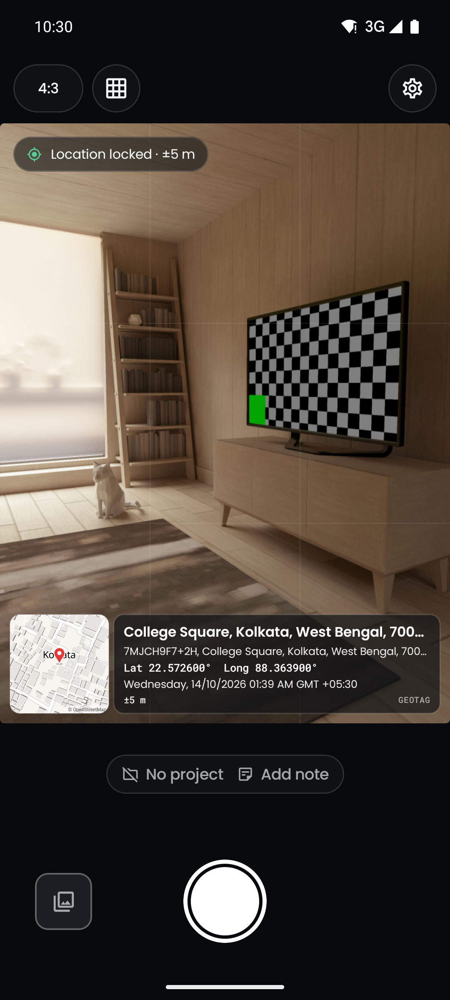
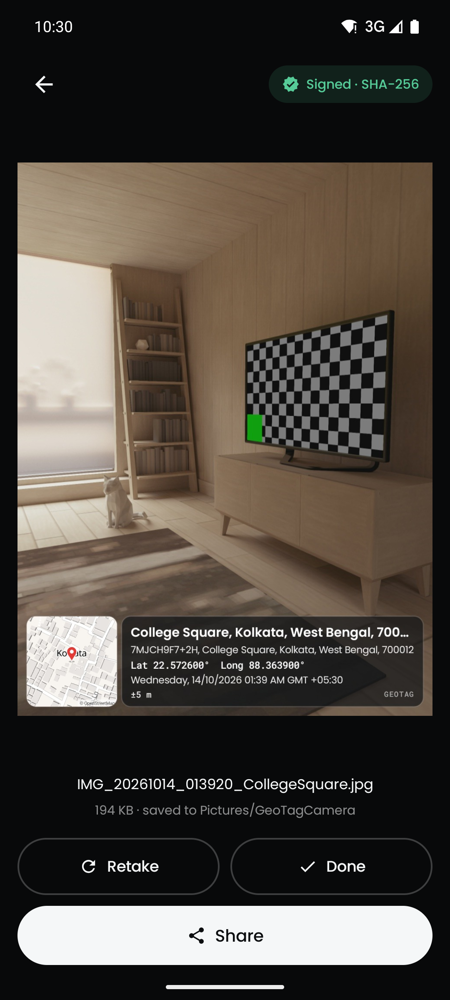
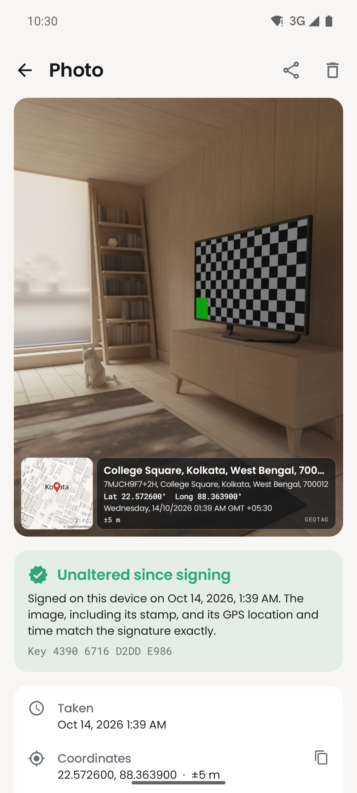
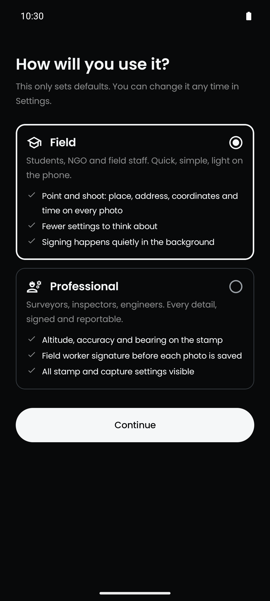
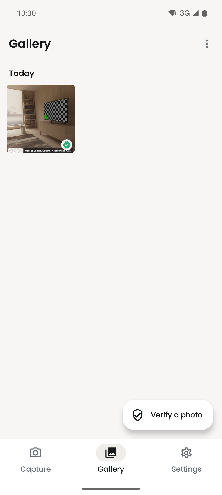
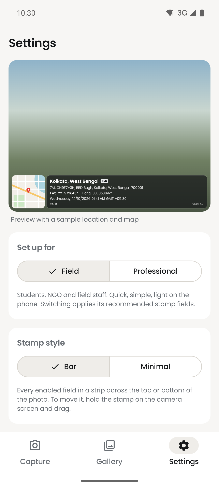
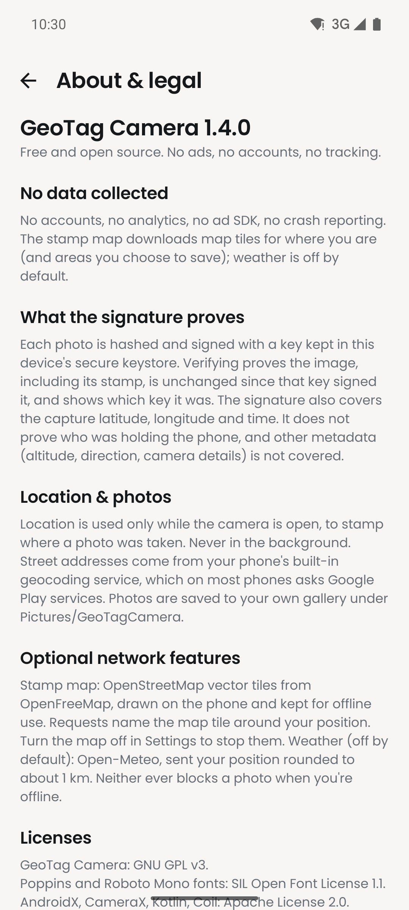
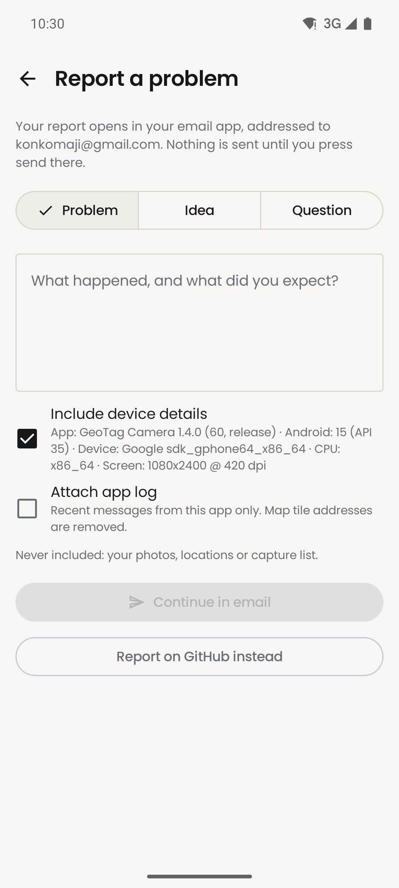

<picture>
  <source media="(prefers-color-scheme: dark)" srcset="assets/banner-dark.svg">
  <source media="(prefers-color-scheme: light)" srcset="assets/banner-light.svg">
  
</picture>

<h1 align="center">GeoTag Camera</h1>

<p align="center">
  <b>Free, open source GPS camera for field work.</b><br>
  Stamps location, address and time on every photo, signs it on the phone, and works with no signal.<br>
  No ads. No paywall. No account. No tracking.
</p>

<p align="center">
  <a href="https://github.com/konkomaji/geotagcamera/releases/latest"></a>
  <a href="https://github.com/konkomaji/geotagcamera/releases"></a>
  <a href="LICENSE"></a>
  
  
  <br>
  <a href="https://github.com/konkomaji/geotagcamera/actions/workflows/android-ci.yml"></a>
  <a href="https://github.com/konkomaji/geotagcamera/actions/workflows/reproducible.yml"></a>
</p>

<p align="center">
  <a href="https://github.com/konkomaji/geotagcamera/releases/latest"></a>
  <a href="https://apps.obtainium.imranr.dev/redirect?r=obtainium://add/https://github.com/konkomaji/geotagcamera"></a>
</p>

<p align="center">
  <a href="https://konkomaji.com/geotagcamera/">Website</a> ·
  <a href="#install">Install</a> ·
  <a href="#features">Features</a> ·
  <a href="#how-photo-verification-works">Verification</a> ·
  <a href="#privacy">Privacy</a> ·
  <a href="CHANGELOG.md">Changelog</a>
</p>

## Screenshots

<table>
  <tr>
    <td align="center" width="25%"><br><sub>Camera with live stamp</sub></td>
    <td align="center" width="25%"><br><sub>Signed right after capture</sub></td>
    <td align="center" width="25%"><br><sub>Photo details and verification</sub></td>
    <td align="center" width="25%"><br><sub>Field or Professional setup</sub></td>
  </tr>
  <tr>
    <td align="center" width="25%"><br><sub>Gallery grouped by day</sub></td>
    <td align="center" width="25%"><br><sub>Settings with stamp preview</sub></td>
    <td align="center" width="25%"><br><sub>Plain-language legal pages</sub></td>
    <td align="center" width="25%"><br><sub>Report a problem by email</sub></td>
  </tr>
</table>

## Why this exists

Most geotagging camera apps make you sit through ads before the camera opens, lock basic stamp fields behind a subscription, ask for permissions that have nothing to do with taking a photo, and stop working when the signal drops. Field surveyors, inspectors, college students and NGO teams need to show where and when a photo was taken, without paying for it or handing over their data. GeoTag Camera does that in the open, so anyone can read the code and check it.

## At a glance

| | |
|---|---|
| **Stamp** | Place, address with Plus Code, coordinates, date and time with GMT offset, accuracy, altitude, bearing, weather and a small map |
| **Proof** | Every photo is hashed with SHA-256 and signed in the Android Keystore; any copy of the app can verify it offline |
| **Offline** | Capture, stamp, sign and verify with no signal; save map areas before a trip |
| **Export** | CSV, KML (Google Earth), GeoJSON (QGIS, ArcGIS) and PDF site reports |
| **Privacy** | No ads, analytics, trackers or account; nothing is sent to the developer |
| **Freedom** | GPL-3.0-or-later, no Google Play services, reproducible builds |

## Features

### Capture
- Camera built on CameraX that adapts to the phone: zoom presets come from the real lenses (0.5x only with an ultra-wide lens), the flash button only shows when there is a flash, and the phone maker's Auto, Night, HDR, Portrait and Retouch modes appear when the phone offers them through CameraX Extensions
- Tap-to-focus with exposure compensation, pinch zoom, rule-of-thirds grid, front and back camera. Front-camera photos match the mirrored preview
- 4:3, 16:9, 1:1 and Full ratios with a smooth switch. The saved photo matches the on-screen frame exactly and stays upright however you hold the phone. Captures are capped at about 12 MP
- Live stamp preview in the viewfinder, drawn by the same code that burns the stamp into the photo
- Two stamp styles. **Bar** (default) is a full-width strip along the top or bottom edge with every field you turn on, about a sixth of a portrait photo. **Minimal** is a small coordinates-and-time label
- Long-press and drag the stamp to move it. Bar snaps to the top or bottom edge, Minimal to one of nine positions
- GPS position, altitude, accuracy, direction, capture time and time-zone offset are also written to EXIF, so GIS and photo tools read them automatically
- Photos go straight to your gallery in Pictures/GeoTagCamera
- After each shot: Retake (discards the photo), Share or Done. The review can close on its own if you turn that on

### Built for the field
- Capturing, stamping, signing and verifying all work with no network
- The stamp map is drawn on the phone from OpenStreetMap data, with no API key. Places you have shot stay available offline, and **Settings → Offline maps** saves a whole area (2 to 30 km) before a trip
- No GPS fix when you press the shutter? The photo is held and saved as soon as a fix arrives
- Location is tracked only while the camera screen is visible, and a fix older than 30 seconds is never used
- With no signal, the stamp uses the nearest address already cached on the phone. The Plus Code is always worked out on the device

### Gallery, projects and reports
- Photos grouped by day, each with a badge showing whether it still verifies
- Multi-select to share or delete; open a location in a maps app or copy the coordinates
- Shoot into a project (a site, job or assignment), filter the gallery by project and move photos between projects
- A sticky note on the stamp (for example "Pole 12, north wall") and an optional fixed custom line (contract number, inspector)
- Export locations as CSV, KML or GeoJSON with time, place, note and each photo's SHA-256
- PDF site report: overview map with numbered pins, an index, and two photos per page with details and a fresh verification result

### For your organization
- **Field** (students, NGO and field staff: simple and quick) or **Professional** (surveyors and inspectors: altitude, bearing, required signature, every setting), chosen on first launch and changeable any time
- Pick exactly which fields show on the stamp, with a live preview
- Your college, company or project name and logo on the stamp, free
- Optional hand-drawn signature on the photo before saving; Settings can make it required

### Trust and verification
- Every photo is signed on the device. The signature covers the image and the capture latitude, longitude and time, so rewriting the GPS or time in EXIF fails verification
- Verify any GeoTag Camera photo, including one someone sent you, from **Verify a photo** or with **Share → Verify with GeoTag Camera**. The result shows the signing key's fingerprint and whether it is this phone's key
- Exactly what this proves and what it does not: [How photo verification works](#how-photo-verification-works)

### Optional, off by default
- Current-weather chip from Open-Meteo. It needs a connection, and a capture never waits for it

## Install

<a href="https://github.com/konkomaji/geotagcamera/releases/latest"></a>
<a href="https://apps.obtainium.imranr.dev/redirect?r=obtainium://add/https://github.com/konkomaji/geotagcamera"></a>

F-Droid: [submission in review](https://gitlab.com/fdroid/fdroiddata/-/merge_requests/52533). Because the builds are reproducible, the F-Droid and GitHub APKs carry the same signature, so you can switch between them without reinstalling.

1. Download the APK for your phone from the [latest release](https://github.com/konkomaji/geotagcamera/releases/latest):

   | APK | For |
   |---|---|
   | `geotagcamera-vX.Y.Z-arm64-v8a.apk` | Most phones from the last several years |
   | `geotagcamera-vX.Y.Z-armeabi-v7a.apk` | Older or budget phones |
   | `geotagcamera-vX.Y.Z-x86_64.apk` | Emulators and x86 devices |
   | `geotagcamera-vX.Y.Z-universal.apk` | Any phone (bigger download) |

2. Optional: check the file against the `.sha256` next to it on the release page.
3. Open the APK on your phone. The first time, Android asks you to allow installs from your browser or file manager; allow it for that app only.
4. Open GeoTag Camera and allow camera and location.

With Obtainium, add `https://github.com/konkomaji/geotagcamera` and filter APKs by `arm64-v8a` (or your phone's ABI).

> [!IMPORTANT]
> **Coming from 1.3.0 or older?** Those builds were signed with a development key. Uninstall the old version first, then install the latest. Photos already in your gallery stay there and still verify. From 1.4.0 on, every release uses the same permanent key and updates in place.

Requires Android 8.0 or newer. Google Play services are not needed.

## Using the app

1. **Frame the photo.** The live stamp on the viewfinder is exactly what will be burned into the photo. Pick a ratio from the top bar.
2. **Move the stamp if needed.** Long-press it and drag.
3. **Take the photo.** Wait for **Location locked** in the corner of the frame; it shows the GPS accuracy.
4. **Review.** Share it, keep it with Done, or Retake (which deletes that photo).
5. **Projects and notes.** Tap the row under the viewfinder to pick or create a project and set a note. Both stay until you change them.
6. **Later.** The Gallery shows every photo with its verified badge. The menu exports locations (CSV, KML, GeoJSON) or builds a PDF report of what is shown or selected.
7. **Check a photo someone sent you.** Settings → Verify a photo, or share the photo to GeoTag Camera from any app.

Settings is where you switch between Field and Professional, choose the stamp style and fields, add your organization's name and logo, save offline map areas and turn on weather.

## How photo verification works

When you take a photo, the app:

1. Renders the stamp onto the image and saves it as a JPEG.
2. Computes a SHA-256 hash over a canonical view of that JPEG: the image data itself (quantization and Huffman tables, frame header and the compressed scan), with every APPn metadata segment left out. EXIF and XMP live there, so the proof can be written into the file without changing the hash. See [`JpegCanonical.kt`](app/src/main/java/com/geotagcamera/geotagginglocationonphoto/exif/JpegCanonical.kt).
3. Signs that hash together with the capture latitude, longitude and time using an ECDSA P-256 key (SHA256withECDSA) generated in the Android Keystore. The private key cannot be exported. On most phones it is held in secure hardware, but that depends on the device.
4. Embeds the hash, the signed latitude, longitude and time, the signature and the public key in the EXIF UserComment, mirrored in an XMP segment, and writes the same latitude, longitude and time into the normal EXIF GPS fields.

Verifying recomputes the canonical hash, checks it against the embedded hash, checks the signature with the embedded public key, and checks that the EXIF GPS latitude, longitude and time still match what was signed. No network or account is involved. The result also shows a short fingerprint of the signing key (four groups of four hex characters) and whether it is this phone's key.

**A "verified" result means** the image pixels (including the burned-in stamp) and the EXIF GPS latitude, longitude and time have not changed since they were signed by the key embedded in the file.

If the image matches but the copy carries no readable GPS or time metadata (sharing apps often strip it), the result is **Image intact, location not checked**. Photos from 1.1.0 carry an older proof that covers the pixels only.

**It does not prove:**
- **Who signed it, or on which device.** The public key travels inside the photo and is not tied to a person or a certificate authority. Someone can strip the proof from an edited photo and re-sign it with their own key. To check who took a photo, get the photographer's key fingerprint through a channel you trust and compare it.
- **That the location or time is true.** The app records what the phone reported. A spoofed GPS fix or wrong clock is signed like any other.
- **The rest of the metadata.** Only latitude, longitude and capture time are signed. Altitude, accuracy, direction, camera details and the XMP segment can change without breaking verification.

Re-encoding a photo, for example when a messaging app compresses it, changes the pixels, so it no longer verifies. Share the original file when verification matters.

## Privacy

Everything stays on your phone unless you share it or turn on an optional online feature. Full policy: [PRIVACY.md](PRIVACY.md).

**Stored on your device only**
- Your photos, in Pictures/GeoTagCamera
- A small database of captures (file, time, coordinates, altitude, accuracy, bearing, address, organization label, hash and signature)
- Cached addresses, map tiles (up to about 150 MB) and any offline map areas you saved
- Your settings and organization logo
- The signing key, inside the Android Keystore

App data is excluded from Android backup, cloud backup and device-to-device transfer. **About & legal → Delete all data** removes the database, settings, logo and caches. Photos already in your gallery stay until you delete them.

**What leaves your device, and when**

| Feature | Default | What is sent | To |
|---|---|---|---|
| Stamp map | On (can be turned off) | Map tile numbers (an area a few km across) and your IP address | OpenFreeMap |
| Weather | Off | Latitude and longitude rounded to about 1 km, and your IP address | Open-Meteo |
| Address lookup | On | Coordinates, through the phone's built-in Android Geocoder (on most phones run by Google) | Your phone's geocoder provider |
| Location | While camera is open | Handled by Android's own location services, which may use Wi-Fi and cell data | Android |
| Sharing a photo | When you choose | The file with its EXIF (exact GPS, altitude, time), stamp and proof | Whoever you send it to |

There are no ads, analytics, crash reporters or tracking SDKs in the app.

## Permissions

| Permission | Why |
|---|---|
| Camera | To take the photo |
| Location (fine and coarse) | GPS for the stamp and EXIF, only while the camera screen is visible, never in the background. Approximate-only still works |
| Internet, network state | Stamp map and offline downloads (OpenFreeMap), optional weather (Open-Meteo). Network state lets the app warn before a big download on mobile data |
| Storage (Android 9 and older only) | To save photos to the gallery. Android 10+ needs no storage permission |

That is the complete list. No contacts, no broad storage access on modern Android, no background location.

## Roadmap

**Next**
- Quick-capture shortcut from the home screen
- Batch mode with auto-numbered notes
- Proof pack: photos, a manifest and signatures in one zip
- A web page that verifies a photo without the app
- Before and after photo pairing
- Hindi and Bengali

**Later**
- Video geotagging
- Track log and distance/area tool
- Voice notes attached to photos
- Home screen widget
- Biometric app lock
- Manual local backup and restore
- Material You dynamic theming

## Tech stack

Kotlin · Jetpack Compose · Material 3 · CameraX and CameraX Extensions · Android location services (no Google Play services) · Android Geocoder · Room and DataStore · Android Keystore · Coil · MapLibre Native with OpenFreeMap vector tiles

## Building from source

You need JDK 17 and the Android SDK with platform 36 (Android Studio Narwhal or newer installs it).

```
git clone https://github.com/konkomaji/geotagcamera.git
cd geotagcamera
./gradlew lintDebug testDebugUnitTest assembleDebug
```

The debug APKs are in `app/build/outputs/apk/debug/`. Minimum SDK 26 (Android 8.0), target SDK 36. Gradle 8.14 (wrapper), Android Gradle Plugin 8.13, Kotlin 2.3. No API keys are needed.

Release builds are reproducible: building a tagged version from source gives a byte-identical APK. CI checks every release on Debian with OpenJDK 17 and 21 ([reproducible.yml](.github/workflows/reproducible.yml)).

## Project status

Current version: **1.4.1**, a maintenance release that makes the build reproducible so F-Droid can ship the same signed APK as GitHub. 1.4.0 was the first full release, with projects, stamp notes, CSV/KML/GeoJSON export, PDF site reports and no Google Play services. Full history: [CHANGELOG.md](CHANGELOG.md).

Found a bug? [Open an issue](https://github.com/konkomaji/geotagcamera/issues), or use **Report a problem** in the app.

## Contributing

Issues and pull requests are welcome. Please read [CONTRIBUTING.md](CONTRIBUTING.md) first, and for a larger change open an issue so we can agree on the approach before you put the work in. Everyone taking part follows the [Code of Conduct](CODE_OF_CONDUCT.md).

Found a security problem, such as a way to make an edited photo verify or a location leak? Please don't open a public issue. See [SECURITY.md](SECURITY.md).

Fonts, map data and libraries are credited in [THIRD_PARTY_NOTICES.md](THIRD_PARTY_NOTICES.md).

## License

GeoTag Camera is licensed under the [GNU General Public License v3.0 or later](LICENSE). You are free to use, study, modify and share it under the same terms.

## Author

Built by [Konko Maji](https://github.com/konkomaji).
